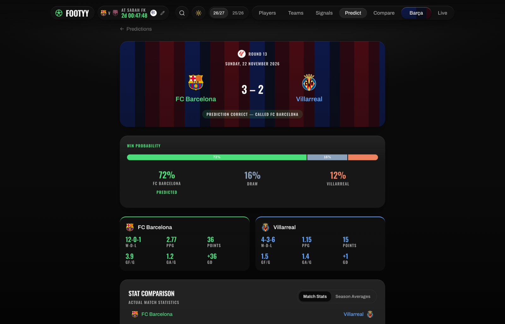
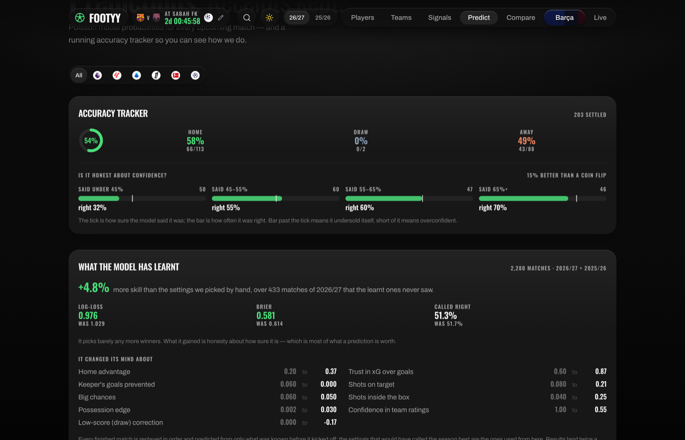
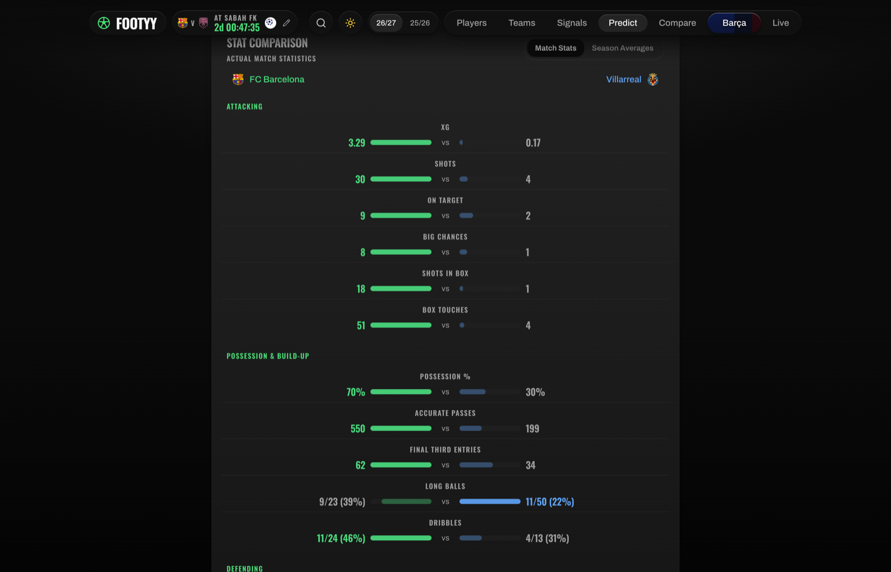
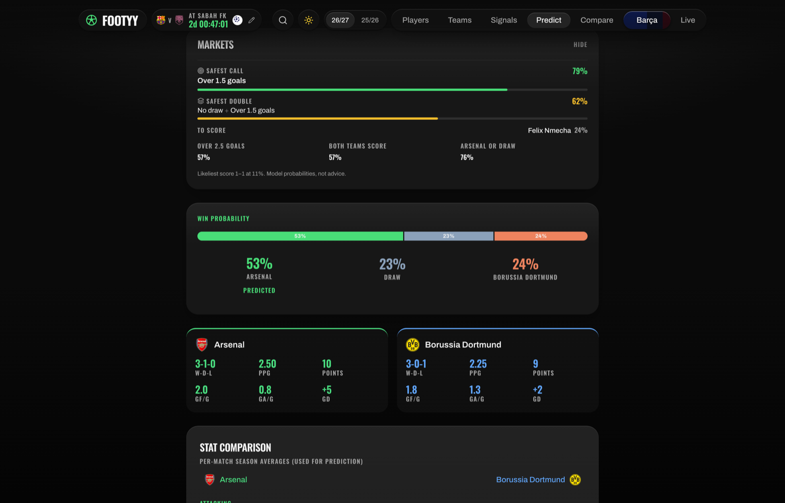
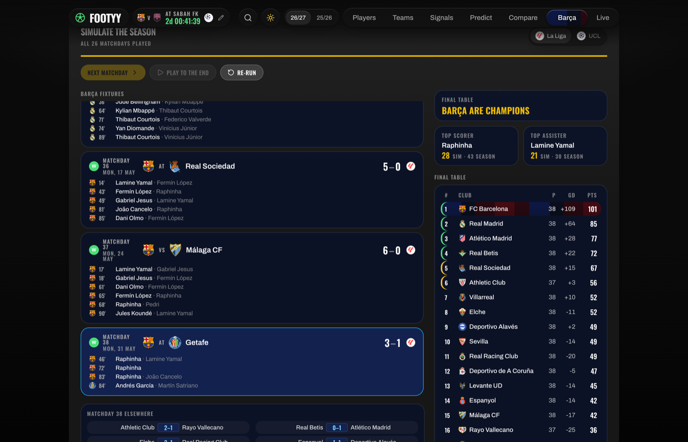
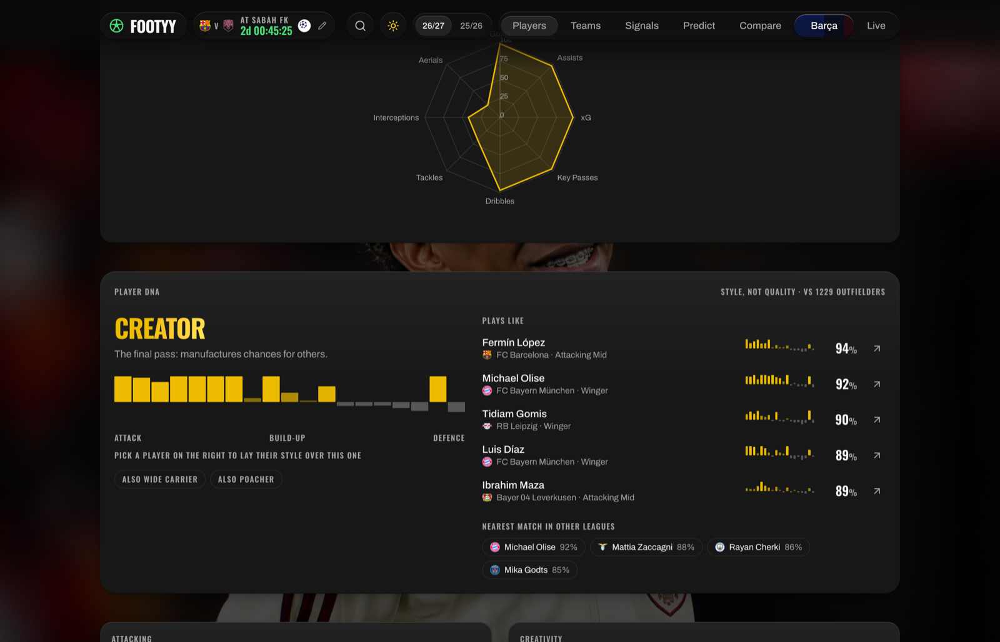
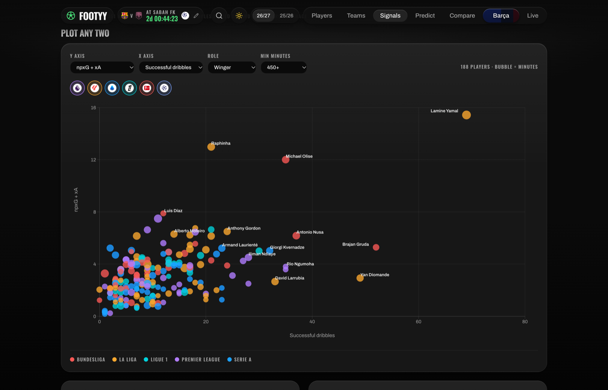
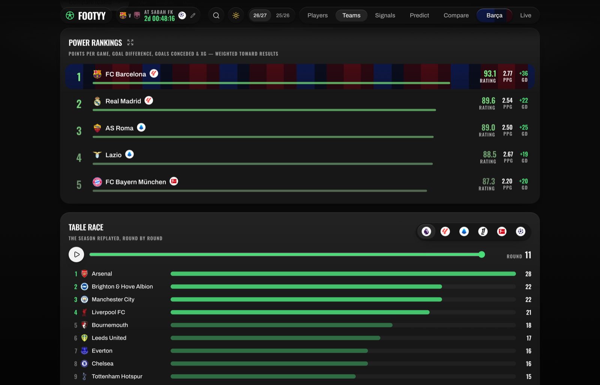
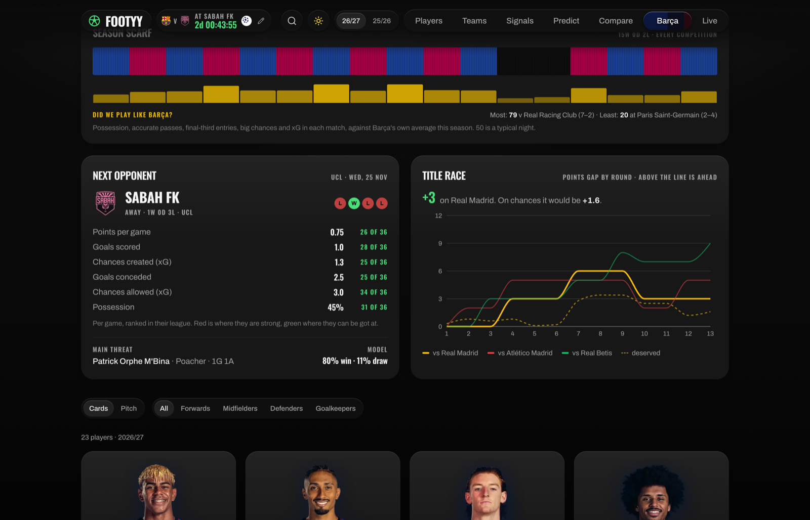

<p align="center">
  
</p>

<h1 align="center">footyy</h1>

**Every match in Europe's big five leagues and the Champions League, in one
database — 53 statistics a fixture, 84 columns a player, two seasons deep —
behind a model that prices every upcoming game, writes its prediction down
before kickoff, and publishes its own scorecard afterwards.**

| | |
|---|---|
| Competitions carried in full | Premier League · La Liga · Serie A · Bundesliga · Ligue 1 · Champions League |
| Clubs | 96 league sides, plus the 36-club Champions League phase |
| Fixtures stored | 3,800+ across 2025/26 and 2026/27 |
| Per-match statistics | 53 per fixture, both sides — 124,000 rows and counting |
| Players | 2,175 tracked, 84 columns each, every count with its per-90 rate |
| Predictions | Locked at kickoff, graded forever, calibration published |
| Typed in by hand | Nothing |

Every single fixture gets its own page — the full scoreline grid priced into
markets, a 53-stat profile comparison between the two sides, both teams' form,
the head-to-head, and the prediction that was on record before anyone kicked a
ball. Every player gets a style fingerprint and an archetype. Every club gets
power rankings, expected points and a round-by-round table race. The rest of
the season can be simulated out, scorers and all, including a Champions League
bracket drawn to UEFA's actual seeding rules.

Next.js 16 (App Router, Cache Components) · React 19 · Supabase · Tailwind v4 ·
a Python scraper on a schedule.



---

## Contents

- [Running it](#running-it)
- [Where the numbers come from](#where-the-numbers-come-from)
- [Predictions](#predictions)
- [Match pages](#match-pages)
- [Markets](#markets)
- [How the model learns](#how-the-model-learns)
- [The season simulator](#the-season-simulator)
- [Players](#players)
- [Signals](#signals)
- [Teams](#teams)
- [Ask](#ask)
- [The Barça deep-dive](#the-barça-deep-dive)
- [Live](#live)
- [What it does not do](#what-it-does-not-do)
- [Project layout](#project-layout)
- [Tests](#tests)

---

## Running it

```bash
npm install
cp .env.example .env.local     # fill in the Supabase values at minimum
npm run dev
```

The site reads from Supabase, so `NEXT_PUBLIC_SUPABASE_URL` and
`NEXT_PUBLIC_SUPABASE_ANON_KEY` are required for anything to render.
`SUPABASE_SERVICE_ROLE_KEY` is only needed to write frozen predictions.
Everything else in `.env.example` belongs to the live and streaming section; the
rest of the site works without it.

The scraper is separate and optional:

```bash
pip install -r requirements.txt
python refresh.py              # fetch, rebuild CSVs, commit and push
python refresh.py --no-push    # leave the commit local
```

| Command | What it does |
|---|---|
| `npm run dev` | Dev server |
| `npm run build` | Production build |
| `npm run start` | Serve the production build |
| `npm run lint` | ESLint |

---

## Where the numbers come from

One scraper, four tables, two runs a day. Nothing on the site is typed in by
hand.

**The feed.** Match results, per-match team statistics and per-player season
totals are scraped from Sofascore by `data_loader.py`. `refresh.py` runs it on a
schedule through launchd, using a persistent browser profile so the bot check
stays solved between runs, then rebuilds the processed CSVs, pushes rows to
Supabase via `sync_db.py` and commits the result.

**What is stored.** Four tables, and the whole site is built from them:

| Table | One row per | Holds |
|---|---|---|
| `matches` | fixture | competition, round, date, kickoff, both sides, score once it exists |
| `match_stats` | statistic per match | both teams' values for all 53 — xG, possession, shots by type, big chances, duels, distance covered, corners, offsides, cards, throw-ins, goal kicks |
| `players` | player per competition per season | 84 columns: every counting stat and its per-90 rate, plus position and role |
| `predictions` | fixture | what the model said, written before kickoff |

**Coverage.** The Premier League, La Liga, Serie A, Ligue 1 and the Bundesliga
are carried in full — all 96 clubs, every fixture, both sides' complete stat
sheet — so their standings are real standings. The Champions League is carried
the same way, all 36 clubs of the league phase. That is roughly 3,800 fixtures
and 124,000 per-match statistic rows across the two seasons held.

Anything else that appears — a cup tie, an international — rides in on a
tracked club's calendar and is deliberately kept out of anything that needs a
season of form behind it.

A player holds a separate row per competition. Pages that rank players fold
those rows together and recompute rates from the combined totals, because a
league rate and a Champions League rate rest on different minutes and cannot
simply be averaged.

---

## Predictions

A goals model, not a results model. It works out how many goals each side should
score, then reads the win, draw and loss chances off that.

**Rating a match.** Each club gets an attack and a defence rating from its season
so far, measured against its own league's average. Attack leans mostly on
expected goals rather than goals scored, because finishing swings far more than
chance creation does. Defence starts from goals conceded, adjusted by the
keeper's goals prevented. The ratings multiply against each other to give both
sides an expected goal count, nudged by shot quality, the possession gap and
home advantage. Those two numbers go through a Poisson, giving every scoreline a
probability, which sums into home win, draw and away win.

**The draw correction.** Treating two teams' scoring as independent is wrong at
low scorelines, and wrong in a specific direction: too few 0-0s and 1-1s. That
is where this kind of model loses draws. A Dixon-Coles correction adjusts
exactly those four scorelines and leaves the rest alone. Its size is fitted, not
assumed.

**The Champions League is modelled separately.** A club plays one or two European
games before its odds matter, far too few to rate it on. So a European rating
blends three things: its games in the competition, its domestic form where that
league is carried, and an average European side, so a thin record is pulled
toward the middle. Backtested on the 2025/26 league phase, 144 matches, by
log-loss:

| Approach | Log-loss |
|---|---|
| European record alone, unshrunk | 1.109 |
| Every team rated average | 1.028 |
| European record, shrunk | 0.976 |
| Plus domestic form (ships) | 0.959 |

On the next season's opening round, which those settings never saw: 0.879
against 0.962 for rating everyone average.

**Receipts.** A prediction is written to the database and shown with its match
forever after. Until kickoff it is free to move and is refreshed whenever the
model changes its mind; at kickoff it locks and never changes again. That is
what makes the accuracy tracker honest — every settled match displays what was
actually said beforehand, not what the current model would say with the result
in hand.

**Calibration, not just hit rate.** Hit rate alone cannot tell you whether a
model is good: one calling every favourite at 90% and one calling them at 55%
score identically when the favourite wins. So predictions are grouped by stated
confidence and checked against how often they came in. The tick on each bar is
the confidence claimed, the bar is how often it was right. Bar past the tick
means it undersold itself; short of it means overconfidence.



---

## Match pages

Every fixture in the database — all 3,800 of them, not a shortlist — has its
own page, and it is the deepest thing on the site.

**The scoreline grid.** The model does not produce a result, it produces a
probability for every scoreline. The page shows what that grid implies: home,
draw and away chances, the likeliest exact score, and the prediction frozen
before kickoff sitting next to the actual result once there is one, labelled
**CORRECT** or **WRONG** in public.

**Playstyle, 53 stats deep.** Both sides' full statistical profile side by
side, grouped into attack, build-up, defending, duels, set pieces and
discipline. A toggle switches the whole board between two readings:

| View | What it shows |
|---|---|
| **Season Averages** | How these two sides play across the season — the style clash, before a ball is kicked |
| **This Match** | Once played, the actual numbers from that night, down to corners, offsides, free kicks, throw-ins and goal kicks |

Each stat is placed as a percentile against the rest of the competition, so
"64% possession" reads as *where that sits* rather than as a bare number.



**Form, head-to-head and live.** Recent results for both clubs with the xG and
shot counts behind them, every previous meeting held in the database, a live
badge and ticking scoreboard while the match is on, and a watch button when a
stream is up.

---

## Markets

A scoreline grid is worth more than three percentages, so every fixture page
prices it out properly.

Each selection is a predicate over scorelines, and its probability is the sum
of the grid cells where it holds — result, double chance, over/under at 1.5,
2.5 and 3.5, both teams to score, clean sheet, likeliest exact score, and a
scorer chance weighted by each player's goals, minutes and the side's expected
goals.

**Doubles are computed, not multiplied.** "Over 2.5" and "both teams score"
lean the same way; multiplying them overstates the pair badly. Summing the
cells where *both* hold gives the exact joint probability with the correlation
already inside it — which is most of the reason to carry a full grid rather
than three numbers.

Near-certainties — over 0.5 goals, under 5.5 — are deliberately left out. They
hold about 95% of the time and tell a reader nothing.



---

## How the model learns

The settings behind the model used to be chosen by hand. They are fitted to
results now, and refitted as results arrive.

A model like this carries a dozen judgement calls — what a home ground is worth,
how far to trust xG over goals, what an above-average shot count really says.
Picked by hand, those numbers never improve and nothing checks whether they were
right.

**Walking the season forward.** Every finished league match is replayed in date
order. Each is predicted using only the record that existed before it kicked
off, and scored on log-loss. Then it is folded into the record and the next
match is predicted. This matters: a fit measured over a finished season has
already seen the answers, while a walk forward only ever grades the call the
model would genuinely have made at kickoff. Coordinate descent then settles on
the settings that would have called the season best.

**What it found.** Fitted on the previous season alone, then marked on 433
matches of the current one that those settings never saw:

| | Log-loss | Brier | Called right |
|---|---|---|---|
| Hand-set | 1.0288 | 0.6138 | 51.7% |
| Learnt | 0.9756 | 0.5811 | 51.3% |

Skill against a coin flip rises from 6.4% to 11.2%. It picks almost no more
winners — the gain is in how sure it is, which is most of what a prediction is
worth.

The largest single correction was to its own confidence: team ratings are pulled
roughly 45% of the way back toward an average scoreline, because the old version
was consistently too bold. Home advantage nearly doubled, trust in expected
goals rose, and the goals-prevented term was switched off entirely as noise.

**Why the previous season stays in the training set.** Tested by holding out the
back half of the current season and scoring all four options on exactly those
matches:

| Trained on | Skill vs coin flip |
|---|---|
| Nothing (hand-set) | 7.3% |
| Current season only | 8.9% |
| Previous season only | 12.2% |
| Both (ships) | 11.9% |

Fitted on the current season's 202 usable matches alone, the model decides home
advantage is 0.05 and gives big chances and shots inside the box *negative*
coefficients. That is 202 matches of noise being read as football. A club's own
form never carries across seasons — the ledger is keyed by season. Only the
general parameters are learnt from older data, and those do not reset in August.

---

## The season simulator

Plays the rest of the season out, match by match, from the same ratings the
predictions use.

**A match.** A simulated scoreline is a draw from the same expected goals the
odds are priced on: two Poisson draws, one per side. Goals are then handed to
players, with scorers drawn from the club's own season weighted by goals,
assists and minutes, so the striker scores more often than the full-back without
anyone hard-coding it. Roughly a quarter are left unassisted, about the real
rate once penalties and solo goals are counted.

**Round by round.** Advance a matchday at a time or let it run. The table
reorders as results land, fixtures fill in with scorelines and scorers, and a
running top scorer and assister build across the season.

**The Champions League bracket.** Once the league phase finishes the bracket is
drawn the way UEFA actually draws it rather than at random. The top eight go
straight to the last sixteen. Ninth to twenty-fourth play off in fixed bands,
9/10 against 23/24 down to 15/16 against 17/18, seeded side at home in the
second leg. Each pair of top seeds meets one band's winners, and the halves are
laid out so 1/2 can only meet 7/8 at the quarter-final stage. Ties are two legs
on aggregate, extra time when level, penalties settled by a weighted coin on the
rating gap. You step through a round at a time.



---

## Players

All 2,175 of them, every one with its own page, 84 columns behind it, and a
style fingerprint. The guiding idea is **style, not quality**: two players match
when they play the same way, whatever their output.

**Player DNA.** Every outfielder gets a fingerprint: per-90 rates turned into
z-scores against everyone else in the cohort. The vector says "does more of this
and less of that than average", which describes shape rather than standard.
Similarity is cosine rather than distance, deliberately — a quiet season of the
same kind of football still points the same direction, so it still reads as the
same kind of player.

**Archetypes.** Each fingerprint is matched against ten named profiles and the
closest is shown: Poacher, Target Forward, Wide Carrier, Creator, Deep
Playmaker, Box-to-Box, Ball-Winner, Stopper, Ball-Playing Defender, Attacking
Full-Back. Goalkeepers get none, and nobody is labelled before 270 minutes.

**Percentiles and comparison.** Stats shown as percentiles against the player's
own position group, so a defender is judged against defenders. Players can be
put side by side on the same axes, as totals or per 90.



---

## Signals

Five derived measures that are not in the feed, each built from columns the
database already holds.

| Signal | Formula |
|---|---|
| Finishing Edge | `goals − xG, per 90` |
| Ball Security | `dispossessed ÷ touches × 100` |
| Progressive Touch % | `(dribbles + final-third passes) ÷ touches` |
| Creator Index | `xA + big chances created + ½ key passes` |
| Ball-Winning Volume | `tackles + interceptions + aerials won, per 90` |

**Finishing Edge** is how far ahead of their chances someone is finishing.
Positive over a long run suggests genuine finishing; over a short one it mostly
suggests luck.

**Ball Security** is losses per hundred touches — a raw count of times
dispossessed punishes anyone who sees a lot of the ball.

**Progressive Touch %** separates players who circulate from players who
advance.

**Creator Index** weights chance creation by how good the chance was, rather
than counting every key pass the same.

**Ball-Winning Volume** is labelled volume rather than dominance on purpose. The
honest version is a win rate — duels won over duels contested — but the attempt
columns that needs come back empty from the feed. Until that is fixed a count is
all the data supports, and a count tracks position.

The page also tracks the biggest movers against last season, in both directions.

**Plot any two.** Beneath the boards is a scatter plot you drive yourself: pick
any metric for each axis, filter to a role and a minutes floor, toggle the five
leagues and the Champions League on or off, and the bubble size carries minutes
played so a small sample looks small. The outliers label themselves, so the
players who separate from the cloud are the ones you can read.



---

## Teams

Full standings for all six competitions, every club clickable through to a
comparison.

**Power rankings.** Clubs ranked on underlying performance rather than points —
points per game, goal difference, defence and xG, each scored against football
norms rather than against the rest of the cohort, and shrunk toward league
average so a 2-from-2 start cannot top a proven leader. Any two clubs can then
be put on the same radar axes.

**Expected points, in the table itself.** Every match's expected goals go
through the same Poisson the predictions use, giving both sides an expected
points figure for that night. Summed across a season, that is what a club
deserved from the chances it created and allowed — carried as an `xPts` column
in every league table, with an arrow for how many places higher or lower the
club would sit on chances alone.

```
points − expected points = how far a club is running ahead of its chances
```

Only matches with expected goals count, and they count for *both* columns —
comparing expected points from nine matches against real points from eleven
would report two games' worth of points as luck.

**Table race.** The season replayed round by round. Keyed by round rather than
date, so a postponed fixture lands in the round it belongs to and the table at
round nine is the one people remember.



---

## Ask

A search box that takes a football question in plain English — "top 3 strikers
in La Liga", "best defensive midfielders this season", "compare Lamine Yamal
and Rodrygo" — and turns it into a retrieval plan over the player table:
position group, how many, which season, rank or compare.

The parsing is **regex, not an LLM call.** It runs in a millisecond, costs
nothing and is testable, with everyday football words mapped onto the role
values in the database — "number 6", "anchor" and "holding midfielder" all land
on the same group, and longer phrases match first so "defensive midfielder"
never resolves as plain "midfielder". The model is spent on judgement, not on
parsing "top 3".

There is also a command palette over every page, club and player in the
database.

---

## The Barça deep-dive

Barcelona is the site's home club and gets a set of pages nothing else does.
Everything above applies to all 96 clubs equally; this part is the one club
taken apart.

**Season scarf.** One stripe per match, oldest on the left: blaugrana for a win,
grey for a draw, black for a defeat. Every competition, in order.

**Did we play like Barça?** Bars under the scarf score each match out of 100 on
how much it looked like Barcelona's own football — possession, accurate passes,
final-third entries, big chances, expected goals. Each stat is measured against
the team's *own* season average rather than the league's. Against the league
Barça play like Barça every week; the interesting question is which weeks they
did not. 50 is a typical night and a standard deviation across the board is
worth 25 points.

**Title race.** The points gap to the nearest rivals after every round, with a
dashed line alongside showing what the gap would be on expected points, so a
lead built on finishing looks different from one built on chances.



**Next opponent.** The upcoming side ranked inside their own league on points
per game, goals scored and conceded, chances created and allowed, and
possession. Red marks where they are strong, green where they can be got at.
Their main threat is whoever has had a hand in the most goals.

**Most-used eleven.** The squad in a 4-3-3 by minutes played. Picked on minutes
because that is what the data can vouch for — it is who has played most, not a
predicted line-up, and the page says so.

**Fixtures and form.** Upcoming matches and recent results with the xG,
possession and shot count from each night, always Barça-first. A match that
finished without a score is treated as postponed rather than a draw, so it never
lands in the form run.

**Leaders.** Squad leaderboards grouped by the role a player actually fills
rather than the broad position — centre-back separated from full-back, winger
from midfielder, because clearances mean nothing when a full-back and a
centre-back share a column. Per-90 boards need 180 minutes before anyone
appears.

---

## Live

Matches are bucketed into in-play, starting soon and upcoming from their kickoff
time, because the feed only ever says `upcoming` or `finished` and never `live`.
A fixture counts as in play for two hours from kickoff.

Any fixture opens to its [match page](#match-pages) — the full breakdown, live
scoreboard and all. The countdown in the header follows Barcelona by default and
can be pointed at any club with fixtures in the database.

The streaming section is password-gated behind `LIVE_ACCESS_PASSWORD` and
aggregates several third-party providers.

---

## What it does not do

**No team news.** Injuries, suspensions, rotation and managerial changes are not
in the data, so they are not in the odds. A side missing its best striker is
rated as though it is not.

**No duel win rates.** The attempt columns needed come back empty from the feed,
so anything duel-related is a count rather than a success rate. Flagged on the
page rather than quietly presented as something it is not.

**Thin goalkeeping.** Saves, claims and sweeper actions are not in the ingested
stat set, so the keeper board shows distribution and minutes instead of
inventing a shot-stopping rating.

**A simulation is one run, not a distribution.** The simulator plays a season,
not ten thousand of them. Re-run it and you get a different one. Treat a single
run as a story rather than a forecast.

**Not betting advice.** The model is published with its own scorecard precisely
so you can see how often it is wrong. It closes about a tenth of the distance
between guessing and certainty — a real edge over a coin flip, and nowhere near
knowing what will happen.

---

## Project layout

```
app/                  routes (App Router)
  predictions/        model output, accuracy tracker, calibration
  predictions/match/  the per-fixture page: grid, markets, 53-stat compare, H2H
  squad/              Barça squad, fixtures, leaders, season simulator
  teams/  signals/  compare/  player/  live/
  api/                route handlers (livescores, simulate, ask, streams)
components/           client components and shared UI
lib/
  learn.ts            model parameters, walk-forward scoring, the fitter
  fitted-model.ts     cached fit, out-of-sample comparison
  predictions.ts      match ratings, Champions League model
  markets.ts          scoreline-grid markets, correlated doubles, best bet
  simulate.ts         season simulator and bracket draw
  justice.ts          expected points, table race
  dna.ts              player fingerprints, archetypes, similarity
  ask.ts              plain-English question → retrieval plan
  barca.ts            scarf, played-like-us, title race
data_loader.py        the Sofascore scraper
refresh.py            scheduled fetch, rebuild, commit, push
sync_db.py            push processed CSVs to Supabase
```

`DESIGN.md` documents the design tokens and visual system.

---

## Tests

Plain Node self-checks, no framework. Each is runnable on its own:

```bash
node lib/learn.test.ts
for f in lib/*.test.ts; do node "$f"; done
```

They cover the model maths and the places where a silent regression would be
expensive: that the fitted defaults reproduce the hand-set model exactly, that
the walk-forward never sees the future, that the bracket draw matches UEFA's
seeding rules, and that a prediction locks at kickoff and not before.

---

## License

[MIT](LICENSE).

Statistics are scraped from Sofascore and are not covered by this licence; the
licence applies to the code in this repository.
